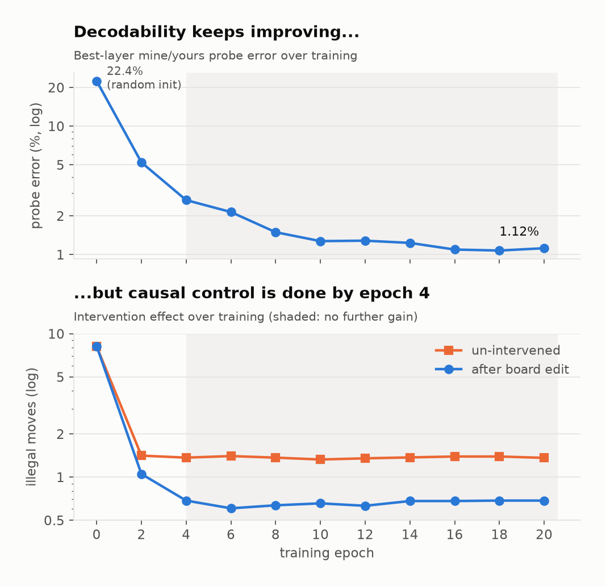
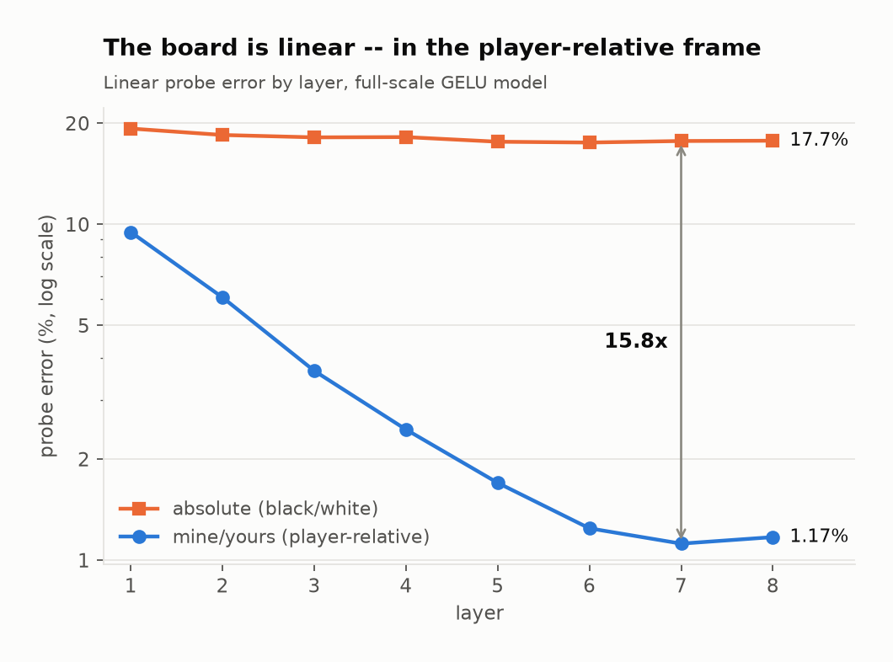
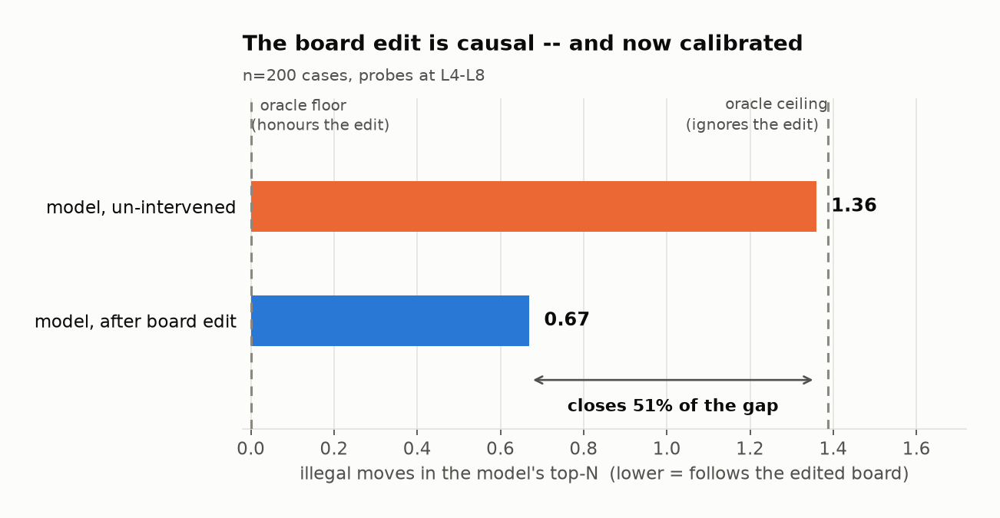
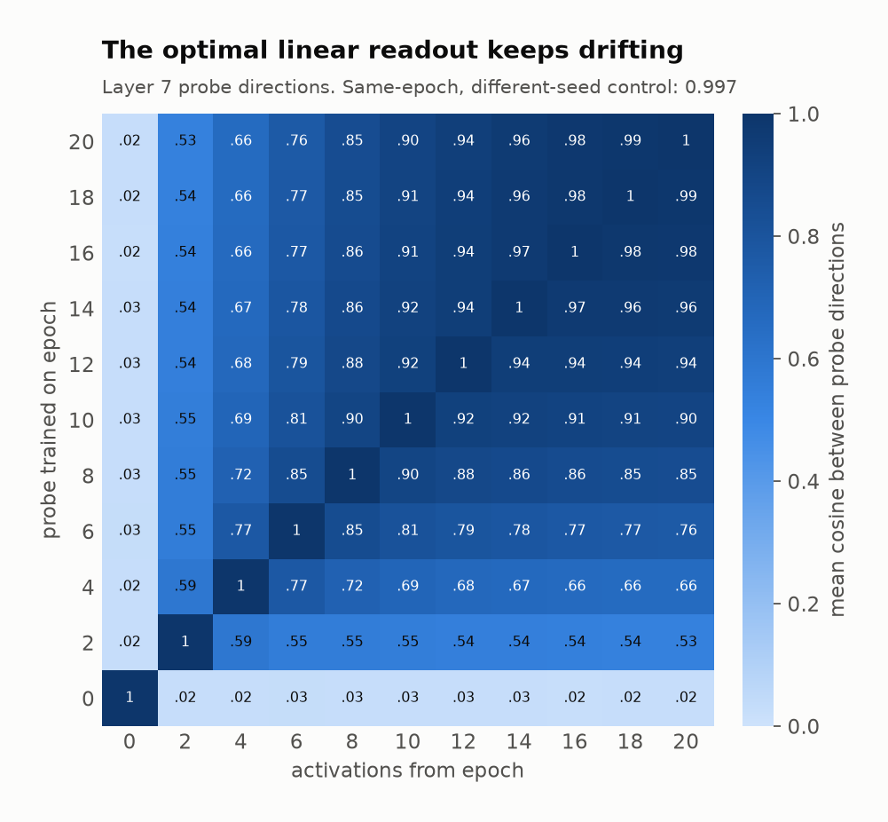
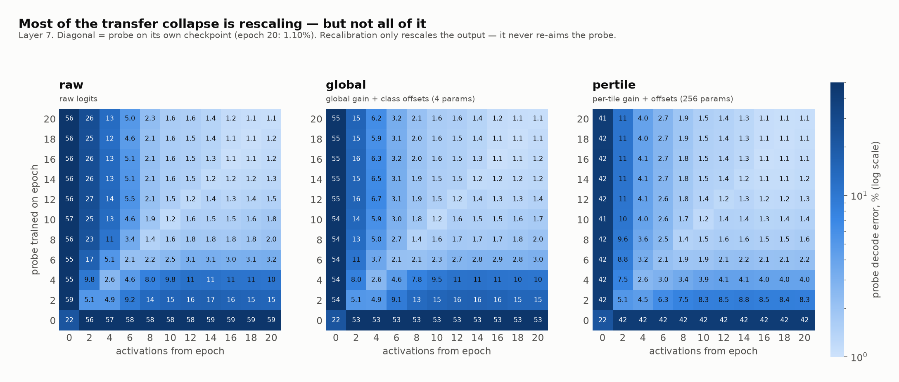

# Othello-GPT: a linear, causal board model and how it emerges

A full-scale reproduction of Othello-GPT ([Li et al. 2023](https://arxiv.org/abs/2210.13382)), extended in three ways: calibrating how *causally* the model uses its internal board, tracing **when** the board appears during training, and checking whether **bilinear MLPs** ([Dooms et al. 2024](https://arxiv.org/abs/2410.08417)) change how readable the board is.

**Full write-up: [REPORT.md](REPORT.md).** Every number below traces to a JSON file in `results/`.

## Headline findings

| # | Finding | Key number |
|---|---|---|
| 1 | The replication holds at full scale | legal-move error 0.046% (authors' checkpoint: 0.017%) |
| 2 | The board is **linear** in the player-relative (mine/yours) frame | 1.12% probe error at L7, vs 17.7% for absolute color (15.8× gap) |
| 3 | The board is **causally used**, and only partially | edits move illegal moves 1.36 → 0.67, against oracle bounds of 0.0 / 1.39, so the intervention closes **~51%** of the gap |
| 4 | **Causal use saturates before decodability does** | intervention efficacy is mature by epoch 4 of 20; probe error keeps falling 2.65% → 1.12% with no extra causal control |
| 5 | The optimal linear readout **drifts** after decodability plateaus | probe-direction cosine, epoch 2 vs epoch 20: 0.53 (same epoch, different seed: 0.999) |
| 6 | Bilinear MLPs match task error but give a **harder-to-read board** | linear mine/yours probe at L7: 2.03% vs 0.99% (GELU), with the board spread over half as many heads |

<picture>
  <source media="(prefers-color-scheme: dark)" srcset="results/figs/fig3_devtrace_dark.png">
  
</picture>

*The board appears within the first few epochs. Causal control is flat from epoch 4 onward, while probe error keeps improving.*

### What is and isn't claimed

- Finding 5 shows that **a probe trained on one checkpoint does not transfer to another**. It does *not* show that the model's encoding rotates. Probe directions depend on the activation covariance, which grows 7–14× over the same epochs. An earlier version of this report claimed rotation; that claim was retracted (REPORT §8). The test that would settle it (comparing generative Δμ directions on normalized activations) is listed under open threads.
- The GELU-vs-bilinear comparison uses one training run per architecture. Two GELU runs bound run-to-run probe noise at about 0.13pp, well under the ~1pp gap, but a single seed per arm can't fully separate architecture from initialization.
- Everything is one model size (25.3M parameters) on synthetic random-legal games.

## Setup

- **Model:** 8-layer, 8-head, 512-d GPT (~25.3M params) trained from scratch to predict legal Othello moves. It uses minGPT, with [likenneth/othello_world](https://github.com/likenneth/othello_world) vendored unmodified in `upstream/`.
- **Architectures:** a GELU baseline, and a parameter- and FLOP-matched bilinear-MLP variant.
- **Anchor:** the authors' released checkpoint, converted from TransformerLens to minGPT and re-scored through the same harness.
- **Calibration:** oracle floor/ceiling for the intervention metric, plus an entropy floor for next-move loss (2.011 nats under random-legal play).

## More figures

<picture>
  <source media="(prefers-color-scheme: dark)" srcset="results/figs/fig1_linearity_dark.png">
  
</picture>
<picture>
  <source media="(prefers-color-scheme: dark)" srcset="results/figs/fig2_intervention_dark.png">
  
</picture>

<picture>
  <source media="(prefers-color-scheme: dark)" srcset="results/figs/fig4_transfer_dark.png">
  
</picture>
<picture>
  <source media="(prefers-color-scheme: dark)" srcset="results/figs/fig5_transfererr_dark.png">
  
</picture>

## Repository layout

| Path | Role |
|---|---|
| `src/gen_data.py` | synthetic game generation (random legal play) |
| `src/train_gpt.py` | train Othello-GPT (GELU or bilinear) and evaluate legal-move error |
| `src/validate_pretrained.py` | convert the authors' checkpoint and re-score it |
| `src/train_probe.py`, `src/nanda_probe.py` | absolute-color and mine/yours board probes |
| `src/intervene_nanda.py`, `src/entropy_floor.py` | causal interventions and oracle calibration |
| `src/dev_study.py` | probe + intervention at every 2nd training epoch |
| `src/probe_transfer.py`, `src/probe_directions.py` | cross-epoch transfer and probe geometry |
| `src/board_map.py` | per-head board decomposition (GELU vs bilinear) |
| `src/report_figs.py` | regenerate the figures from result JSONs |
| `configs/config.yaml` | every setting, with `pilot` and `full` profiles |
| `slurm/` | one Slurm job per stage |
| `results/` | result JSONs, figures, and longer write-ups |

## Reproducing

All stages run as Slurm jobs. Set the paths in `configs/config.yaml` for your cluster first.

```bash
sbatch slurm/gen_data.slurm                      # 1. synthetic games (CPU)
TJ=$(sbatch --parsable slurm/train_gpt.slurm)    # 2. train the GPT
sbatch slurm/validate.slurm                      # 3. anchor on the authors' weights
sbatch --dependency=afterok:$TJ slurm/nanda_probe.slurm        # 4. probes
sbatch --dependency=afterok:$TJ slurm/intervene_nanda.slurm    # 5. interventions
sbatch slurm/report_figs.slurm                   # 6. figures
```

The `pilot` profile (~100k games, 1 GPU) smoke-tests the whole pipeline. For paper scale, pass `--export=ALL,PROFILE=full`. The full map from each result to its script, job and output file is in REPORT §12.

## References

- Li et al. 2023, *Emergent World Representations: Exploring a Sequence Model Trained on a Synthetic Task*. [arXiv:2210.13382](https://arxiv.org/abs/2210.13382)
- Nanda et al. 2023, *Emergent Linear Representations in World Models of Self-Supervised Sequence Models*.
- Dooms et al. 2024, *Bilinear MLPs enable weight-based mechanistic interpretability*. [arXiv:2410.08417](https://arxiv.org/abs/2410.08417)

Main runs used the UW Hyak "klone" cluster under Jason Hendrick's account, with his permission.
