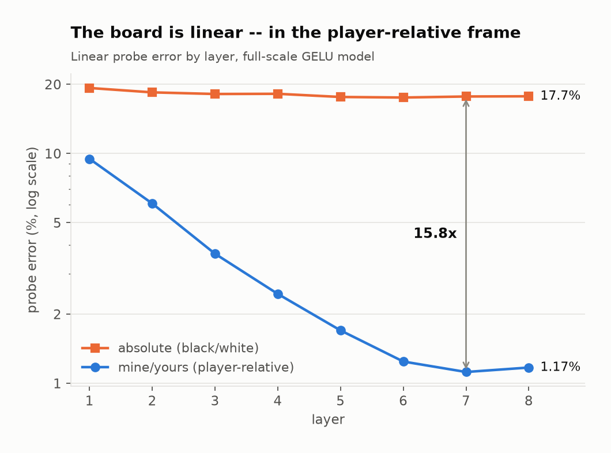
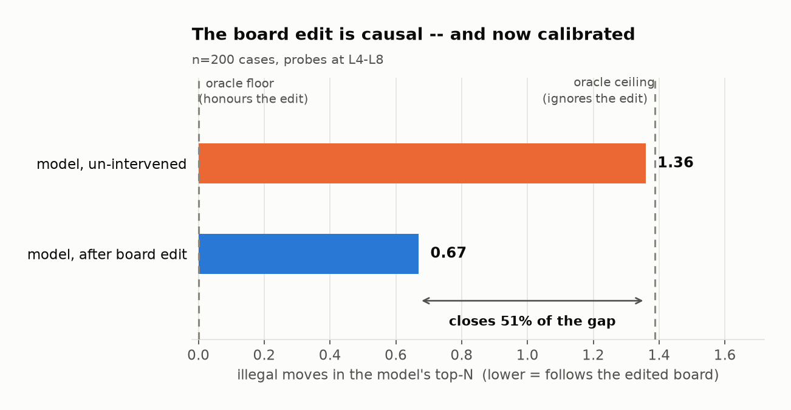
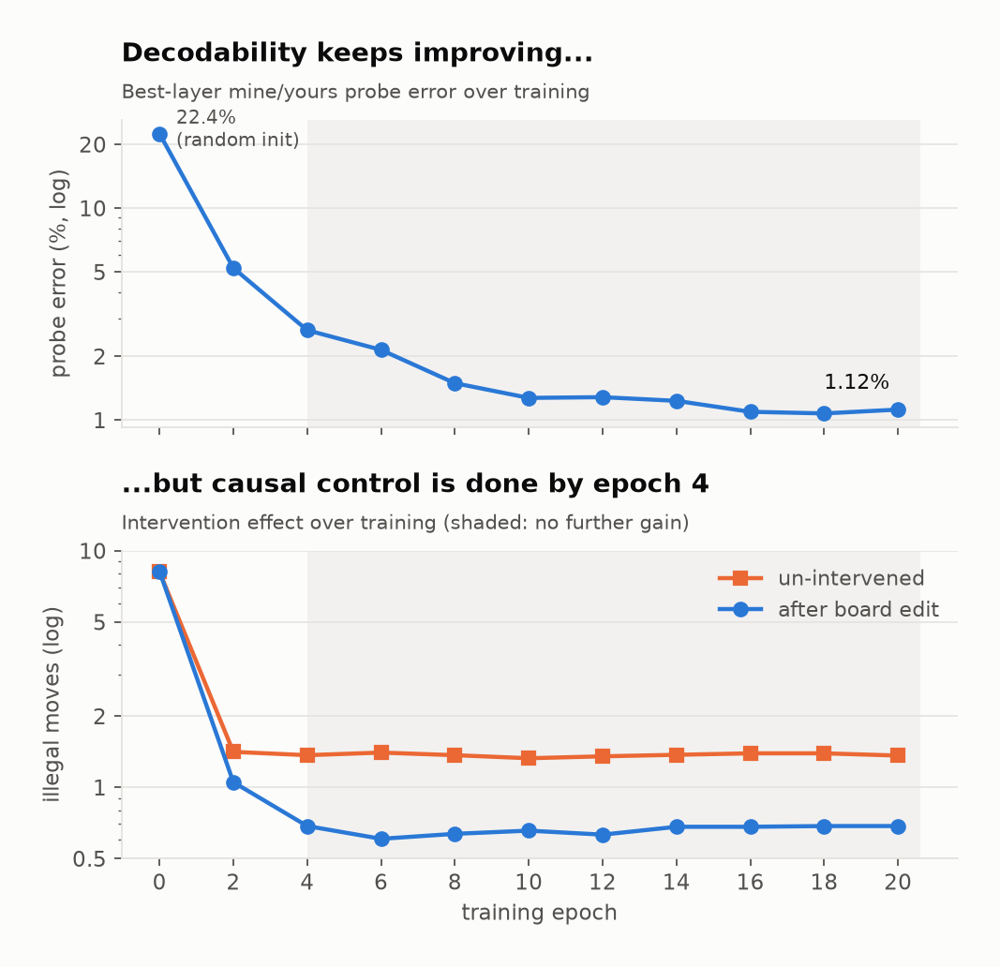
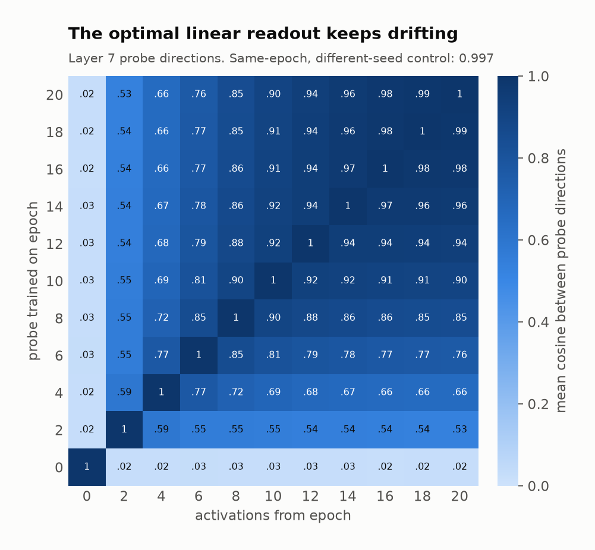
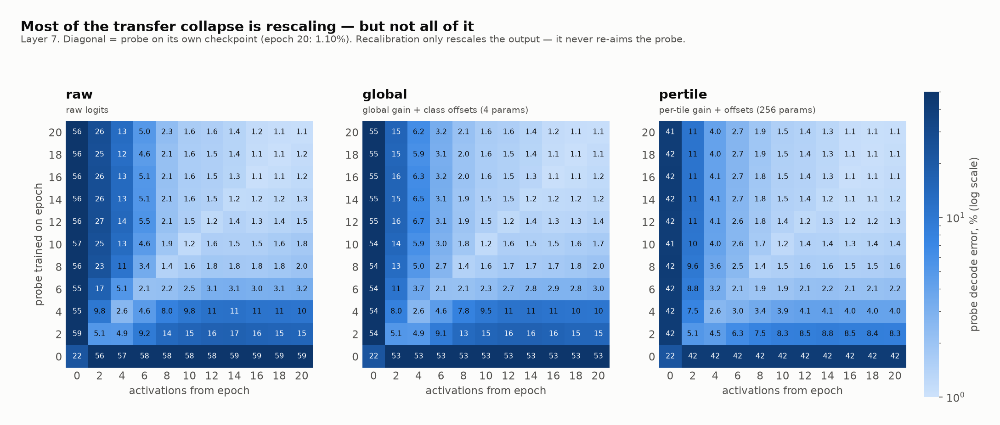

# Othello-GPT: A Linear, Causal Board Model and How It Emerges

**Research report — outline form.** Last updated 2026-08-02.
Repo: `BilinearOthelloGPT` · all numbers below trace to a file in `results/`.

---

## 0. One-paragraph summary

We reproduce Othello-GPT (Li et al. 2023) at full scale, then push past
replication on three fronts. The board world-model is **linear in the
player-relative (mine/yours) frame** and **causally used** — and we calibrate
just *how* causally used, against oracle bounds computed from the game engine.
Training-time tracing then shows the board appears very early (~epoch 2–4 of 20)
and its *causal* usefulness saturates well before its *decodability* does, while
the probe directions themselves keep slowly rotating for the entire run.
Swapping the MLPs for bilinear MLPs solves the task equally well but leaves the
board measurably harder to read.

---

## 1. Headline findings (the four things worth remembering)

| # | Finding | Key number | Source |
|---|---|---|---|
| 1 | Replication holds at full scale | legal-move error **0.046%** (authors' ckpt 0.017%) | `gpt_full_h200_eval.json` |
| 2 | Board rep is **linear** in the mine/yours frame | **1.12%** err @ L7 vs **17.7%** absolute-color — a 15.8× gap | `nanda_probe_full_h200.json` |
| 3 | The board is **causally used**, and we now know how much | 1.36 → **0.67** illegal moves; calibrated floor 0.0 / ceiling 1.39 ⇒ intervention closes **~51%** of the gap | `intervention_nanda_full_h200.json`, `floors_full_h200.json` |
| 4 | The representation **drifts throughout training** even after it stops improving | probe cosine ep2↔ep20 = **0.53**, but cross-seed control at fixed epoch = **0.999** | `probe_transfer_full_h200.json` |

---

## 2. Setup

- **Task/model**: 8L / 8H / 512d GPT (~25.3M params), block size 59, 61-token
  vocab, trained from scratch on synthetic random-legal Othello games. minGPT
  under the hood, upstream `likenneth/othello_world` vendored unmodified.
- **Two architectures, param- and FLOP-matched**:
  - `gelu` — standard baseline.
  - `bilinear` — bilinear MLPs (Dooms et al. 2024, arXiv:2410.08417),
    expansion 8/3. A drop-in MLP replacement with no elementwise nonlinearity.
- **Anchor**: the authors' released checkpoint, converted TransformerLens →
  minGPT, re-scored through our harness (self-check: ~0 legal-move error).
- **Compute**: UW Hyak *klone*. Main runs on H200/A100; analysis jobs on A40.
  Full bilinear train = one 47h job on 2×A100-80GB.

---

## 3. Result 1 — Replication (the baseline everything else stands on)

- Legal-move error, full scale: **GELU 0.032%**, **GELU/H200 rerun 0.046%**,
  **bilinear 0.036%** — vs authors' anchor 0.017%. All three architectures solve
  the task equivalently.
- Classic probe picture reproduces: **linear absolute-color probe never beats
  ~17.6%**, while a **nonlinear (MLP) probe hits 1.41% @ L7**. This is the
  original paper's "the board is there but not linearly readable" result.
- **New calibration — an entropy floor for the loss.** Under random-legal play
  the irreducible next-move cross-entropy is
  **2.011 nats** (train; mean 8.62 legal moves/position). Any reported loss
  should be read against this, not against 0.

## 4. Result 2 — The board is linear, in the right frame

- Replicating Nanda's reframing: label tiles **mine/yours** (relative to the
  player to move) instead of black/white, and train a *single* linear probe
  across both plies.
- **1.12% error @ L7** vs **17.7%** for the absolute-color linear probe.
- Interpretation: the earlier "nonlinearity" was a **coordinate-frame artifact**.
  The model stores a player-relative board, and it stores it linearly.
- Layer profile: error falls monotonically L1→L7 (9.5% → 1.12%), flat at L8 —
  the board is *built* through the mid stack and *consumed* at the top.

<picture>
  <source media="(prefers-color-scheme: dark)" srcset="results/figs/fig1_linearity_dark.png">
  
</picture>

## 5. Result 3 — Causal use, now with a calibrated scale

- **Intervention**: train mine/yours probes at L4–L8, edit one tile in the
  residual stream, propagate the edit layer-by-layer, score how many of the
  model's top-N moves are illegal *on the edited board*.
- Measured: **baseline 1.36 → intervened 0.67** illegal moves (200 cases).
- **New: what do those numbers mean?** We computed reference points directly
  from the game engine:
  - **0.000** = an oracle that fully honours the edit (floor).
  - **1.388 ± 0.547** = an oracle that completely *ignores* the edit and plays
    the true board (ceiling).
- So: the un-intervened model sits **exactly at the "ignores the edit" ceiling**
  (1.36 vs 1.388 — as it must), and the intervention moves it **~51% of the way
  to a perfect edit-follower**. The edit is genuinely causal, and it's
  genuinely partial. This replaces a previously uncalibrated metric.

<picture>
  <source media="(prefers-color-scheme: dark)" srcset="results/figs/fig2_intervention_dark.png">
  
</picture>

## 6. Result 4 — Bilinear MLPs: same task error, slightly worse-read board

- Bilinear matches GELU on the task (**0.036% vs 0.032%** legal-move error), so
  the architecture swap costs nothing on the objective.
- But its board is consistently **~2× harder to read**:

  | Probe | GELU | Bilinear |
  |---|---|---|
  | nonlinear @ L7 | 1.41% | 2.60% |
  | linear mine/yours @ L7 | 0.99% | 2.03% |

- The mine/yours linearity result of §4 reproduces in bilinear too (2.03%
  mine/yours vs 16.8% absolute = 8.3× gap), so this is a difference in how
  *sharply* the board is written, not in what kind of representation it is.
- **The board code is about half as redundant under bilinear.** Decomposing the
  linear mine/yours readout over all 64 attention heads, the number that
  correlate with it at **> 0.3** is:

  | | GELU | Bilinear |
  |---|---|---|
  | heads with board_corr > 0.3 | **18 / 64** | **9 / 64** |
  | strongest heads | A5.h5 0.61, A6.h5 0.54, A7.h5 0.45 | A5.h3 0.58, A6.h0 0.57, A5.h6 0.36 |

  The *peak* is essentially unchanged (0.61 vs 0.58) — bilinear is not missing a
  strong board signal, it just spreads it over half as many heads. That the
  sparser code is also the harder-to-read one is suggestive, but with one seed
  per architecture it is a correlation between two numbers, not a demonstrated
  cause. Source: `board_map_full{,_bilinear}.json`.
- We did not pin down what drives the readability gap; it is reported here as an
  observation, not an explanation.
- Detail and the supporting per-layer numbers: `results/bilinear_comparison.md`.

## 7. Result 5 — Developmental trace: when does the world model appear?

Probing + intervening at every 2nd epoch of a 20-epoch full run:

| Epoch | best mine/yours probe err | intervention (base → intervened) |
|---|---|---|
| 0 (init) | 22.4% | 8.14 → 8.18 *(no effect — control)* |
| 2 | 5.2% | 1.41 → 1.05 |
| 4 | 2.65% | 1.37 → 0.69 |
| 8 | 1.49% | 1.37 → 0.64 |
| 20 | 1.12% | 1.36 → 0.69 |

- **The board arrives early**: 22% → 5% within 2 epochs, → 2.65% by epoch 4.
- **Causal saturation precedes decodability saturation**: intervention efficacy
  is fully mature by **epoch 4** and never improves again, while probe error
  keeps falling 2.65% → 1.12% over the remaining 16 epochs. The last 60% of
  probe improvement buys **zero** additional causal control.
- Reading: late training refines a representation the model was *already* using
  as much as it ever will — a decodability/causality dissociation.
- Epoch-0 numbers double as the random-init control (22% probe error is the
  class-prior floor; intervention does nothing).

<picture>
  <source media="(prefers-color-scheme: dark)" srcset="results/figs/fig3_devtrace_dark.png">
  
</picture>

## 8. Result 6 — The representation keeps rotating *(newest result)*

Probe-transfer study: train a probe on epoch *i* activations, apply it to
epoch *j*; also compare probe directions directly.

- **Cross-epoch cosine (L7)**: adjacent late epochs ≈ 0.99, but
  **ep2 ↔ ep20 = 0.53**, and **ep0 ↔ anything ≈ 0.02**. A smooth monotone decay
  away from the diagonal, at both L4 and L7.
- **Transfer error (L7, per-tile recalibrated)**: on-diagonal 1.09% @ ep20, but
  the epoch-2 probe applied at epoch 20 gives **8.3%** — and on raw (un-recalibrated)
  logits, cross-epoch transfer collapses to ~50%+ error.
- **Critical control**: two probes trained at the *same* epoch with different
  seeds agree at **cosine 0.997–0.999**, subspace 0.996–0.999, identical error.
  So the drift is a property of the **model**, not probe-training noise.
- Interpretation: decodability plateaus by ~epoch 10, but the **basis in which
  the board is written keeps slowly rotating for the whole run**. Probes are
  checkpoint-specific; "the board direction" is not a fixed object across
  training.
- **Geometry side-note**: the 64 tile directions are **not** low-dimensional —
  top-3 PCs explain only **9.2% (L4) / 10.0% (L7)**. No compact 3D board
  manifold; the board is a genuinely high-rank code.

<picture>
  <source media="(prefers-color-scheme: dark)" srcset="results/figs/fig4_transfer_dark.png">
  
</picture>

### 8.1 How much of the collapse is real? *(raw / global / pertile)*

Transfer error alone can't separate "the probe is aimed wrong" from "the probe
is aimed fine but its outputs come out at the wrong scale" — the residual stream
grows during training. So each stale probe is scored three ways, each of which
only ever **rescales** its output and never re-aims it: `raw` (untouched),
`global` (one gain + three class offsets, 4 params), `pertile` (per-tile gain +
offsets, 256 params). Whatever error survives `pertile` is genuine drift.

| L7, probe → activations | raw | global | pertile | own-epoch |
|---|---|---|---|---|
| ep2 → ep20 | 15.2% | 14.8% | **8.3%** | 1.10% |
| ep20 → ep2 | 26.3% | 15.4% | **10.6%** | 5.12% |
| mean off-diag (ep ≥ 2) | 6.9% | 5.2% | **3.5%** | — |

- **Most of the apparent collapse is rescaling** — ep20→ep2 halves from 26.3% to
  10.6% under recalibration. Reports of "~50% error on raw logits" are mostly a
  scale artefact and shouldn't be quoted as drift.
- **What survives is still large**: 8.3% vs a native 1.10% is ~8× the own-epoch
  error, and ~300× the same-epoch seed-control spread. The rotation is real.
- **The decay is asymmetric.** A late probe read backwards is worse than an early
  probe read forwards (26.3% vs 15.2% raw) — the cosine matrix is symmetric by
  construction and hides this. Late probes are *more* specialised to their own
  checkpoint than early ones are.
- **Epoch 0 is the control** and behaves as it must: ~42% under every correction,
  i.e. recalibration cannot rescue a probe that was never aimed at anything.

<picture>
  <source media="(prefers-color-scheme: dark)" srcset="results/figs/fig5_transfererr_dark.png">
  
</picture>

---

## 9. What this adds up to

1. **Frame matters more than nonlinearity.** The original "needs a nonlinear
   probe" result dissolves under the player-relative frame.
2. **Causal claims need a scale.** "1.36 → 0.67" means nothing until you know
   the oracle bounds; against them it is a real but partial (~51%) effect.
3. **Emergence is early, and the refinement afterwards is causally inert.**
   Probe error and causal control come apart after epoch 4.
4. **A probe is a statement about one checkpoint.** The board stays decodable
   while the directions encoding it keep rotating.

## 10. Limitations / caveats

- Probes are trained on held-out **synthetic** games (upstream used championship
  games). Representational question unchanged; absolute numbers not directly
  comparable to the paper's championship track.
- The intervention legality metric is **reconstructed** (upstream never shipped
  the exact scoring) — §5's floor/ceiling calibration is the fix for that, but
  cross-paper comparison of the raw number is still unsafe.
- Developmental study: epochs 0–14 recorded only the best layer's probe error
  (a preempted-job bug, fixed after that run); full per-layer breakdown exists
  from epoch 16 on.
- Intervention n = 200 cases; transfer/PCA studies use 2,000 games
  (117,961 positions), single seed for the model itself.
- Everything is one model size (25.3M) on one synthetic distribution.

## 11. Open threads (ranked)

1. **Why does causal efficacy cap at ~51%** of the calibrated floor? Is the
   remaining half a probe-quality limit, or does the model also read the board
   from somewhere the edit doesn't reach?
2. **Multi-seed models** to test whether the rotation in §8 converges to a
   seed-independent endpoint, or is genuinely seed-specific.
3. **Does the rotation have structure?** It is smooth and monotone — worth
   checking whether it is drift along a low-dimensional manifold or diffuse.
4. **What makes the bilinear board less sharp** at equal task error (§6).
5. **Championship-game track** to make the numbers directly comparable to the
   paper's.

## 12. Reproduction map

| Result | Code | Job | Output |
|---|---|---|---|
| Training / eval | `src/train_gpt.py` | `slurm/train_gpt*.slurm` | `gpt_*_eval.json` |
| Anchor | `src/validate_pretrained.py` | `slurm/validate.slurm` | `validate_pretrained.json` |
| Classic probes | `src/train_probe.py` | `slurm/train_probe.slurm` | `probe_*.json` |
| Mine/yours probe | `src/nanda_probe.py` | `slurm/nanda_probe.slurm` | `nanda_probe_*.json` |
| Intervention | `src/intervene_nanda.py` | `slurm/intervene_nanda.slurm` | `intervention_nanda_*.json` |
| Floors/calibration | `src/entropy_floor.py` | `slurm/entropy_floor.slurm` | `floors_full_h200.json` |
| Developmental study | `src/dev_study.py` | `slurm/dev_study_full_h200.slurm` | `dev_study_full_h200.json` |
| Probe transfer | `src/probe_transfer.py` | `slurm/probe_transfer.slurm` | `probe_transfer_full_h200.json` |
| Probe geometry | `src/probe_directions.py` | `slurm/probe_directions.slurm` | `probe_pca3d_full_h200.json` |
| Board-code redundancy (§6) | `src/board_map.py` | `slurm/board_map.slurm` | `board_map_full{,_bilinear}.json` |
| Report figures | `src/report_figs.py` | `slurm/report_figs.slurm` | `results/figs/*.png` |

Longer-form writeups: `results/nanda_linear_probe.md`,
`results/bilinear_comparison.md`.

**Figures.** The four above are regenerated from the result JSONs by
`sbatch slurm/report_figs.slurm` (light + dark variants; the report serves each
via `<picture>`). Additional per-study plots already in `results/`:
`nanda_probe_full*.png`, `probe_transfer_full_h200_L{4,7}.png`,
`dev_study_full_h200.png`.

**Side analyses not part of this study.** The repo also contains a
weight-space thread (`src/attn_ov_board.py`, `src/bilinear_eigen.py` and their
outputs, written up in `results/weight_space_interpretability.md`). It is kept
for reference and is not claimed as a result here: that the board is carried by
attention rather than the position-wise MLPs is close to definitional, since
attention is the only component that moves information across tokens. §6 uses
the same decomposition only to *count* board-carrying heads across the two
architectures, which is a claim about the architecture swap, not about where the
board lives.

## 13. References

- Li et al. 2023, *Emergent World Representations* — arXiv:2210.13382
- Nanda et al. 2023, *Emergent Linear Representations in World Models*
- Dooms et al. 2024, *Bilinear MLPs enable weight-based mechanistic
  interpretability* — arXiv:2410.08417

*Compute on UW Hyak "klone" under Jason Hendrick's account, used with
permission.*
