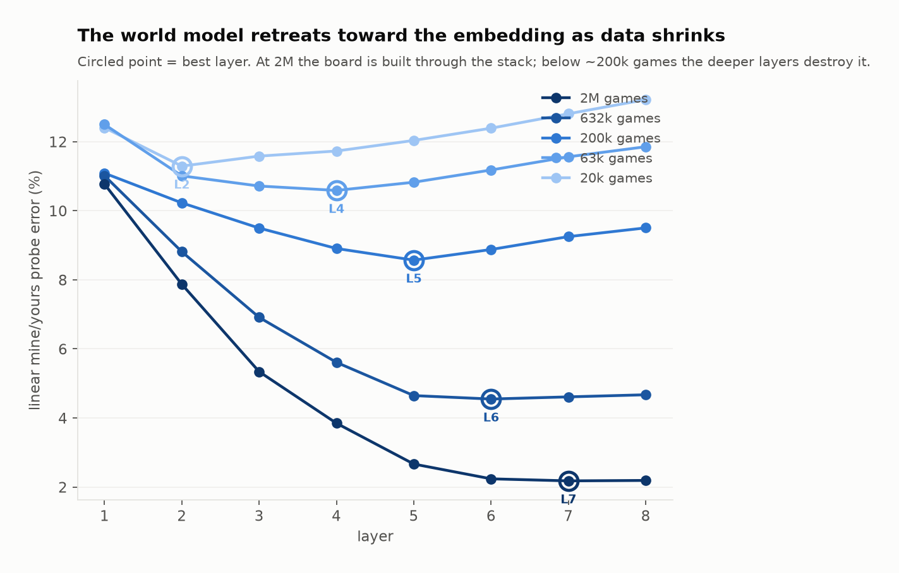

# Data scaling and the world model

**Question.** Does restricting training data force Othello-GPT toward a compact,
general algorithm, or does it just produce a worse model? Specifically: does the
linear player-relative board representation survive, or even sharpen, when there
is not enough data to memorise?

**Answer: it does not.** The linear world model degrades monotonically with data,
and the linearity result that motivates the whole player-relative frame collapses
along with it. The interesting structure is not in the error magnitudes but in
*where in the network* the board lives.

---

## 1. Setup

Five models, identical in every respect except the number of unique training
games:

| | |
|---|---|
| architecture | 8L / 8H / 512d GELU, 25.3M params (unchanged) |
| optimiser steps | **39,062 at every point** (40M game-presentations, batch 1024) |
| weight decay | **0.0** (the repo default — see §5) |
| val split | fixed 10,000 games, identical across points, excluded from every train set |
| sizes | 2M, 632k, 200k, 63k, 20k games |

Holding *steps* rather than *epochs* constant is the point: with fixed epochs the
small-data runs would simply be undertrained, and the experiment would measure
compute rather than data. Epochs therefore range from 20 (2M games) to 2,000
(20k games), putting the small end in the many-passes regime where
memorise→generalise transitions are reported.

Each checkpoint is then scored with the unmodified `nanda_probe.py` (linear
mine/yours vs absolute-colour, all 8 layers) and `ood_eval.py`.

Reproduce:

```
NGAMES=200000 PRESENTATIONS=40000000 BATCH=1024 TAG=sweep_n200000 \
    sbatch bag_of_heuristics/slurm/train_sweep.slurm
NGAMES=200000 sbatch bag_of_heuristics/slurm/probe_sweep.slurm
```

---

## 2. Headline numbers

| games | epochs | legal-move err | best mine/yours | best absolute | linearity gain |
|---|---|---|---|---|---|
| 2,000,000 | 20 | **0.105%** | **2.18%** (L7) | 17.31% | **7.95×** |
| 632,000 | 63 | 0.704% | 4.55% (L6) | 17.71% | 3.89× |
| 200,000 | 200 | 3.016% | 8.57% (L5) | 17.42% | 2.03× |
| 63,000 | 635 | 4.884% | 10.59% (L4) | 16.54% | 1.56× |
| 20,000 | 2,000 | 5.689% | 11.29% (L2) | 17.29% | 1.53× |

Two things to read off this table.

**The linearity advantage is a function of data, not of architecture.** The
absolute-colour probe is pinned near 17% at every scale — it is the class prior
and carries no information. The mine/yours probe is what moves. At 2M games the
7.95× gap reproduces the qualitative result in `REPORT.md` §4; by 20k games the
gap is 1.53× and the player-relative frame has bought essentially nothing. The
"the board is linear in the right frame" finding is a property of the data-rich
regime, and it is not robust to data reduction.

**There is no transition anywhere on the curve.** Probe error, task error and
every OOD metric move monotonically in the same direction. Nothing groks.

<picture>
  <source media="(prefers-color-scheme: dark)" srcset="results/figs/figs2_sweep_summary_dark.png">
  
</picture>

---

## 3. The main result: the world model retreats toward the embedding

Per-layer linear mine/yours error (%), best layer in bold:

| games | L1 | L2 | L3 | L4 | L5 | L6 | L7 | L8 |
|---|---|---|---|---|---|---|---|---|
| 2,000,000 | 10.77 | 7.87 | 5.34 | 3.85 | 2.66 | 2.24 | **2.18** | 2.19 |
| 632,000 | 11.01 | 8.81 | 6.91 | 5.61 | 4.65 | **4.55** | 4.61 | 4.67 |
| 200,000 | 11.09 | 10.23 | 9.50 | 8.91 | **8.57** | 8.88 | 9.25 | 9.50 |
| 63,000 | 12.50 | 11.01 | 10.71 | **10.59** | 10.82 | 11.18 | 11.56 | 11.85 |
| 20,000 | 12.40 | **11.29** | 11.58 | 11.73 | 12.03 | 12.39 | 12.81 | 13.22 |

The best layer moves **L7 → L6 → L5 → L4 → L2** as data shrinks by two decades.

At 2M games the profile is monotone decreasing: every layer improves the board
estimate, the board is *constructed* across the stack, and it plateaus at the top
where it is consumed. This is the shape reported in `REPORT.md` §4.

At 20k games the profile is monotone *increasing* after L2. The best board
estimate available anywhere in the network sits two layers in, and the remaining
six layers make it steadily worse — L2 11.29% degrading to L8 13.22%. The deep
layers are not building a world model; they are destroying board information
while fitting something else.

The intermediate sizes interpolate cleanly, so this is a smooth movement of a
single feature rather than five unrelated profiles.

<picture>
  <source media="(prefers-color-scheme: dark)" srcset="results/figs/figs1_layer_inversion_dark.png">
  
</picture>

**Reading.** A linearly-decodable board at L2 is close to what the token and
position embeddings plus two attention layers can produce by direct
accumulation — recent moves, roughly where they were played. It is the cheap part
of the board. What the data-rich model adds in L3–L7 is precisely the expensive
part: resolving flips, which requires composing across the sequence. Under data
scarcity the model does not learn a cheaper version of that computation. It stops
attempting it, keeps the shallow approximation, and spends its depth elsewhere.

This is the opposite of the compression hypothesis. Restricting data did not
force the flip rule to be found; it removed the pressure to find it at all.

---

## 4. OOD behaviour

| games | identity | rot180 | transpose | antitrans | mean TV | uniform | corner_first | ratio |
|---|---|---|---|---|---|---|---|---|
| 2,000,000 | 0.305% | 0.345% | 0.311% | 0.401% | 0.056 | 0.294% | 1.409% | 4.8× |
| 632,000 | 2.018% | 2.097% | 2.068% | 1.871% | 0.234 | 1.752% | 4.124% | 2.4× |
| 200,000 | 8.138% | 8.087% | 8.494% | 8.494% | 0.572 | 7.933% | 13.029% | 1.6× |
| 63,000 | 14.485% | 18.023% | 14.022% | 16.260% | 0.760 | 15.572% | 21.385% | 1.4× |
| 20,000 | 17.221% | 33.068% | 25.387% | 31.327% | 0.847 | 26.545% | 32.728% | 1.2× |

Orientation equivariance degrades sharply (TV 0.056 → 0.847): small-data models
compute visibly different functions in relabelled frames.

**Do not read the last two columns as heuristic-ness.** Once absolute error is
17–33%, TV and the corner-first ratio are dominated by general incompetence, not
by square-specific rule-fitting — a uniformly broken model has a small *relative*
OOD gap for trivial reasons. Only the 2M and 632k rows are interpretable as
generalisation measurements. The 63k and 20k rows are included for completeness.

Note also the spread across the four legality-preserving orientations at 20k
(17.2 / 33.1 / 25.4 / 31.3): the data-rich model is orientation-invariant to
within 0.1 points, the data-poor model is not invariant at all.

---

## 5. Caveats

- **Weight decay is 0**, inherited from `configs/config.yaml`. This sweep is
  therefore scarcity *without* regularisation, which is the standard recipe for
  memorisation rather than grokking. It is the correct control but not the
  interesting arm; the `wd=0.1` sweep (`TAG=sweepwd_n*`) is the comparison.
- **39,062 steps may be too few for a grokking transition.** Reported
  memorise→generalise transitions often need 10^5–10^6 steps. If the `wd=0.1` arm
  shows partial movement, extending steps at the small end is cheap and is the
  next thing to try.
- **The 2M point is not comparable to `REPORT.md`'s full-scale numbers**
  (batch 1024 / 40M presentations here vs batch 4096 / ~400M there). Read the
  sweep internally.
- **Two legality metrics disagree.** At 2M games `train_gpt.py` reports 0.105%
  but `ood_eval.py`'s identity condition reports 0.305% on the same checkpoint.
  Different sample sizes, but a 3× gap over ~17k positions exceeds noise and is
  consistent with the permissive `update()` check in
  `evaluate_legal_move_error` (upstream `umpire` silently swaps colour on a
  move that flips nothing, so some illegal moves score as legal). `ood_eval.py`
  checks `get_valid_moves()` per ply and is the stricter number.

---

## 6. What this settles, and what it does not

Settled: **data scarcity alone is not a route to an algorithmic world model in
this setup.** Every metric degrades monotonically, no transition appears, and the
board representation retreats to the shallowest layers rather than becoming
sharper or more compact. Compression pressure applied purely by removing data
does not buy generalisation here.

Open: whether scarcity *plus* regularisation behaves differently. That is the
running `wd=0.1` arm, and the layer profile is the diagnostic to watch — the
signature of success is the best layer moving back *up* the stack at small data,
which would mean the model reacquired the flip computation with less evidence.
